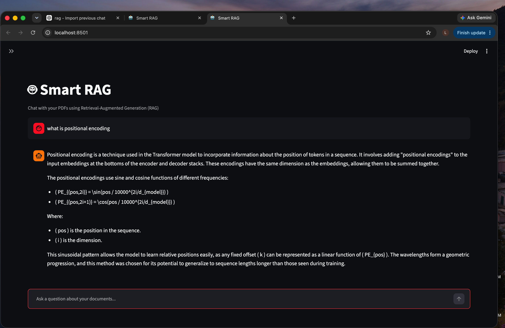
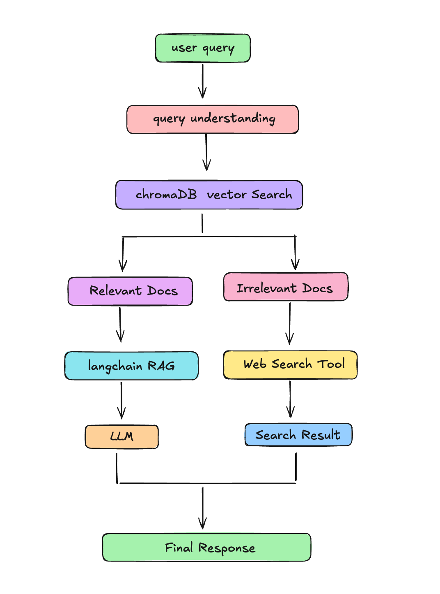
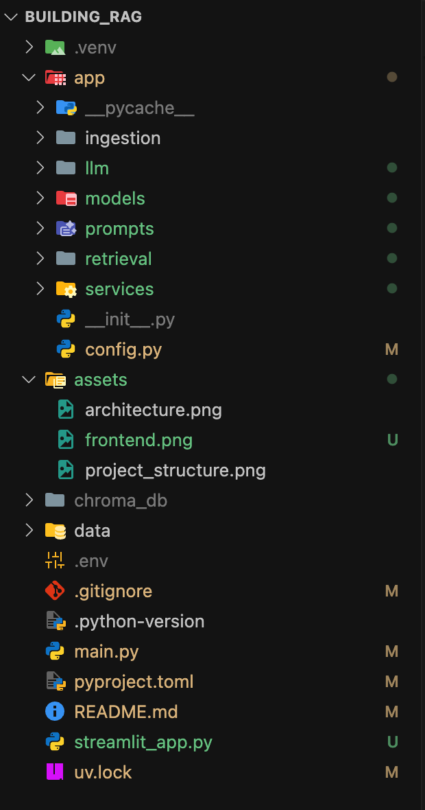

# RAGify - Retrieval Augmented Generation System using Langchain & ChromaDB 

### Hi! Welcome to my project. This is a RAG System which can tell you all the information about the Research Paper Named "Attention is all you Need".

<p align="center">
  <a href="assets/frontend.png">
    
  </a>
</p>

I built this project while learning and  which will teach you that how to build your own custom RAG system. 

# Architecture

<p align="center">
  <a href="assets/architecture.png">
    
  </a>
</p>


# Tech Stack

**Programming Language:** Python 

**LLM Framework:** LangChain

**Vector Database:** ChromaDB

**LLM:** OpenRouter

**Frontend:** Streamlit

**Embedding Model:** sentence-transformers

**Document Loader:** LangChain Document Loaders

**Chunking:** RecursiveCharacterTextSplitter

**Environment Management:** uv

**Version Control:** Git & GitHub


# Features

* Intelligent Document Chunking 
* Semantic search using embeddings
* Answers are generated with respect to Context
* Intelligent Web Search feature
* Interactive Streamlit interface


# Project Structure

<p align="center">
  <a href="assets/project_structure.png">
    
  </a>
</p>


# How It Works


 1. PDF documents are loaded from the `data/pdfs` directory.

2. Documents are split into smaller chunks.
3. Each chunk is converted into embeddings.
4. Embeddings are stored in ChromaDB.
5. User queries are embedded and matched against stored chunks.
6. Relevant context is sent to the LLM to generate grounded answers.
7. If the text is Irrelevant then it will search from the Web.  


## Installation

```bash
git clone <repo-url>
cd <project>
```

### 2. Create virtual environment

```bash
uv venv
source .venv/bin/activate
```

### 3. Install dependencies

```bash
uv sync
```

<!-- ## Environment Variables

Create a `.env` file:

```env
OPENAI_API_KEY=your_key_here
``` -->

## Instruction to run the project

Step 1 — Ingest Documents

```bash
uv run main.py
```
This will:

* Load PDFs

* Split documents into chunks

* Generate embeddings

* Store embeddings inside ChromaDB

Step 2 — Start the Streamlit UI
```bash
uv run streamlit run streamlit_app.py

```


 ⭐ If you found this project helpful, consider giving it a star.

#  🚧 Actively Under Development